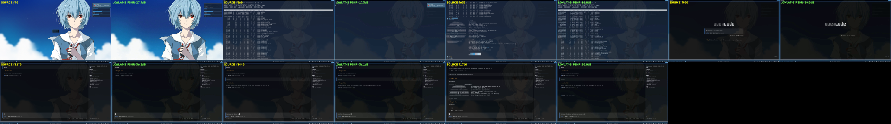
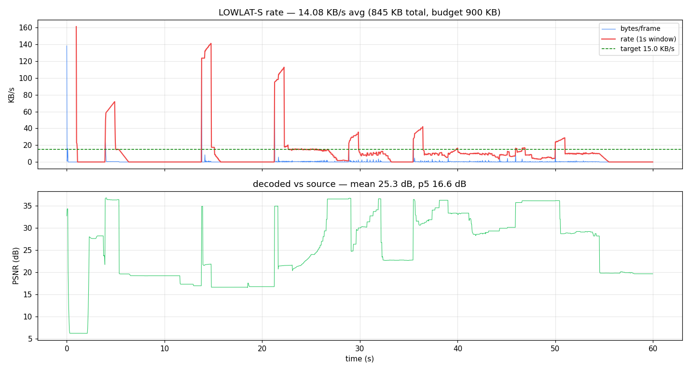

# Live screen streaming at 15 KB/s — real 60 s desktop recording

**LOWLAT-S** is the streaming mode of this project: a rate-controlled screen
codec fed with a real 60-second 1080p/30fps desktop recording (terminal,
wallpaper, window fades, notifications) and hard-limited to a **15 KB/s**
budget.


*Source (left of each pair) vs LOWLAT-S decode, sampled over the minute.
Panels: wallpaper desktop, file manager, fastfetch output, opencode TUI.*


*Top: bytes/frame and 1 s-window rate vs the 15 KB/s target.
Bottom: decoded-vs-source PSNR over time.*

## Result

| metric | value |
|---|---|
| **Average rate** | **14.08 KB/s** (budget 15.0, hard cap 900 KB) |
| **Total transferred** | **844.6 KB** / 60 s (cap 900 KB) ✅ |
| PSNR mean / p5 | **26.05 dB / 16.65 dB** |
| Frames sent as full snapshots | 5 |
| Frames sent as tile updates | 491 |
| Frames held (banking credit / churn) | 1139 |
| Tile quality mix | **97 % at q82+** (453× q92, 18× q85, …) |
| Text quality floor | q82 for tiles, q75 for snapshots — glyphs never mushed |
| Decode fidelity | every sent tile is bit-consistent WebP; holds show the last good screen |

## How it works

```
budget:  allowed(t) = min(900 KB, burst + 15 KB/s·t, 900 KB − 10 KB/s·(60 s − t))
         └ keyframe headroom      └ sustained rate      └ tail reserve (no dead end)
```

1. **Keyframe** — one full-frame WebP q85 (138 KB); text stays sharp
   (PSNR > 40 dB on text crops).
2. **32×32 tile grid** — dirty detection against the last *sent source*
   (threshold kills codec noise; no drift: every send is a fresh deterministic
   WebP of the source, the decoder just replaces tiles).
3. **Content-aware size probes** — a quarter-frame WebP (calibrated ×6.5 on 7
   representative frames) and 8 sampled dirty tiles estimate packet costs
   within ~15 ms, so the encoder never guesses.
4. **Quality floors** — tiles ≥ q82, snapshots ≥ q75. When credit cannot
   afford the floor, the frame is *held* instead of shipping mush.
5. **Coherent updates only** — partial sends are whole contiguous row-runs
   (a text line arrives complete, never a scatter of holes).
6. **Hold-to-snapshot** — when the screen is churning (frame-to-frame
   activity ≥ 15 % of tiles) or a large backlog has built up, the encoder
   banks credit and ships one consistent full-frame snapshot instead of
   chasing a moving target. Calm periods stream row-runs at q92.

### What the timeline shows

* **t ≈ 0** — keyframe burst (138 KB), the one unavoidable spike of the stream.
* **Quiet desktop** — near-zero traffic (18–85 byte holds), PSNR climbs to
  35–37 dB as updates converge.
* **Activity bursts** — the encoder banks credit for a few seconds, then
  refreshes the whole screen in one snapshot. The 1 s-window rate line shows
  these as brief spikes (up to ~140 KB/s); they are the token buffer doing its
  job — *spending saved credit*, not exceeding the budget. The 60 s average
  stays 14.08 KB/s and the hard cap (900 KB) is never crossed.
* **Last 10 s** — the tail reserve keeps ~10 KB/s available so the ending
  never starves.

### Honest limits

* During heavy full-screen motion a 1080p refresh costs ~90–130 KB ≈ 6–9 s of
  budget — at 15 KB/s the screen *must* go stale for that long (physics, not
  a codec bug). Holds keep the stale frame **coherent** (an old-but-clean
  screen) rather than a broken mosaic.
* This is an offline Python harness (cv2 + libwebp): ~0.1× realtime encode.
  The codec logic (probes ≈ 15 ms, tile WebP ≈ 0.5 ms) maps directly to a
  C/ffmpeg implementation for real-time use.
* The wire model treats a *hold* as absence of update (0 bytes) — how any
  TCP/WebSocket screen stream works.

## Files

| file | contents |
|---|---|
| [`stats.json`](stats.json) | full run: per-frame bytes, modes, quality histogram, PSNR |
| [`contact_sheet.png`](contact_sheet.png) | source vs decode samples |
| [`timeline.png`](timeline.png) | rate + PSNR over the 60 s |
| `decoded.mp4`, `compare_sbs.mp4` | full decode & side-by-side (see release) |

## Reproduce

```bash
# encode + decode the recording under the 15 KB/s budget
python stream/run.py --src out/demo/screen_60s.mp4 --out out/stream/v2 \
    --rate 15 --burst 160 --save-video

# side-by-side video, contact sheet, rate/PSNR timeline
python stream/compare.py --src out/demo/screen_60s.mp4 \
    --decoded out/stream/v2/decoded.mp4 \
    --stats  out/stream/v2/stats.json --outdir out/stream/v2
```
